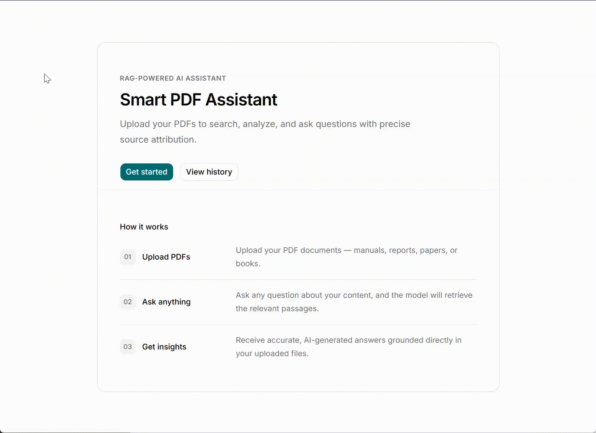

# 📋 RAG App

An intelligent **Retrieval-Augmented Generation (RAG)** application designed for processing, indexing, and querying documents. The system leverages **vector search** and automated background workflows to deliver accurate, context-aware answers based on uploaded files.

Built as a **full-stack application**, it combines **vector database** capabilities, **background task** execution, and structured data storage to manage document pipelines effectively.

## Demo

Sample documents for testing the application can be found in the `./samples` directory.




## Key Features

- **Document Upload & Ingestion:** Upload documents to automatically parse, chunk, and process them via background tasks.
- **Vector Search & Semantic Retrieval:** Utilizes Qdrant for fast and precise similarity search over embedded document chunks.
- **RAG-Powered Chat:** Answers user queries using LlamaIndex and retrieved context for accurate responses.
- **Background Event Workflows:** Asynchronous processing of document indexing and embeddings via Inngest.
- **Relational Data Management:** Persists document metadata, application states, and chat histories using SQLite and SQLAlchemy.
- **Containerized Stack:** Seamless orchestration of frontend, backend, vector store, and event engine using Docker Compose.

## Tech Stack

### Backend

- **Python 3.14+**
- **FastAPI** — High-performance web framework for API development
- **SQLAlchemy** — ORM for relational database interactions
- **SQLite** — Lightweight relational database management system
- **Alembic** — Database migrations management tool
- **LlamaIndex** — Data framework for connecting custom data sources to LLMs
- **Qdrant** — High-performance vector database for semantic search
- **Inngest** — Event-driven background task and workflow orchestration engine
- **uv** — Fast Python package manager

### Frontend

- **React** — UI library
- **TypeScript** — Strongly typed programming language for safe and scalable UI development
- **Vite** — Next-generation frontend tooling and build server
- **shadcn/ui** — Reusable, accessible UI components
- **Tailwind CSS** — Utility-first CSS framework

### Containerization & Infrastructure

- **Docker & Docker Compose** — Multi-container orchestration for local development and consistent environments


## Local Development (via Docker Compose)

The easiest way to run the entire application stack (Frontend, Backend, Qdrant, and Inngest) is using Docker Compose.

### Prerequisites

- [Docker Desktop](https://www.docker.com/products/docker-desktop/) (includes Docker Compose)
- Git

### Quick Start

1. **Clone the repository:**
```bash
git clone https://github.com/nata-kostina/rag-app.git
cd rag-app
```

2. **Set up Environment Variables:**
Copy the example .env files in both backend and frontend directories and configure your credentials (e.g., OpenAI API keys):
```bash
cp backend/.env.example backend/.env
cp frontend/.env.example frontend/.env
```

3. **Start the Stack with Docker Compose:**
```bash
docker compose up --build
```
4. **Access Application Services:**
- **Frontend App:** [http://localhost:5173](http://localhost:5173)
- **Backend API Docs (Swagger):** [http://localhost:8000/docs](http://localhost:8000/docs)
- **Inngest Dev Server UI:** [http://localhost:8288](http://localhost:8288)
- **Qdrant Dashboard:** [http://localhost:6333/dashboard](http://localhost:6333/dashboard)

5. **Stop the Application:**
To stop all running containers and preserve your SQLite and Qdrant data volumes:
```bash
docker compose down
```


## Local Development (Manual Setup)

If you prefer running services individually without Docker:

### Prerequisites

- Python 3.14+
- Node.js v24+
- [pnpm](https://pnpm.io/)
- [uv](https://github.com/astral-sh/uv)

### Steps

1. **Backend Setup:**
```bash
cd backend
cp .env.example .env
uv sync
uv run alembic upgrade head
uv run --locked --no-sync uvicorn app.main:create_app --factory --reload
```
2. **Inngest Dev Server:**
In a separate terminal, start the Inngest CLI dev server:
```bash
npx inngest-cli@latest dev -u http://127.0.0.1:8000/api/ingest --no-discovery
```
3. **Frontend Setup:**
In a separate terminal:
```bash
cd frontend
cp .env.example .env
pnpm install
pnpm dev
```